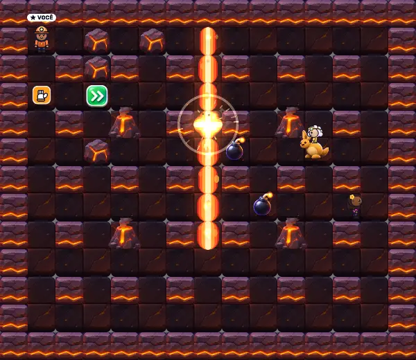
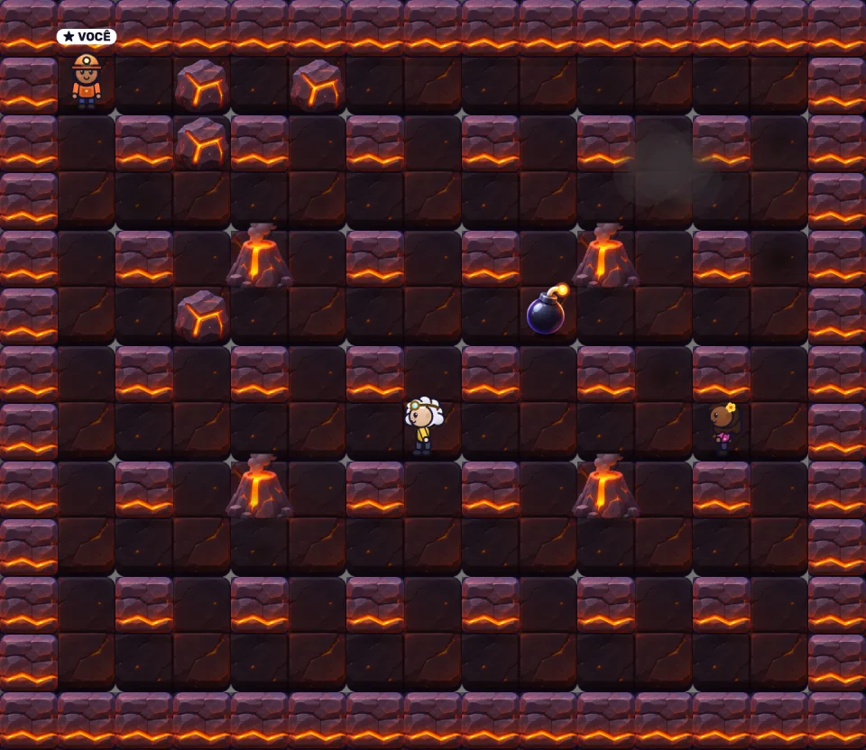

# Pavio Curto

**A real-time multiplayer bomb arena game that runs in the browser.** Up to 4 players (or bots) drop bombs, ride pets, grab power-ups and try to be the last one standing.

**Play it:** https://opaviocurto.com.br · Portuguese docs: [README.pt-BR.md](README.pt-BR.md)



## Features

- **Real-time multiplayer** for up to 4 players per room, plus spectators and room chat
- **Bots** with 3 difficulty levels that dodge blasts, chase players and use pet abilities
- **9 stages** with their own hazards: volcanoes, rivers and waterfalls, trains, tornadoes, hiding tunnels, a whale that swallows players, and cracking ice
- **5 pets** with active abilities: dash (cat), jump (kangaroo), bomb line (tank), shield (lion) and fire breath (dragon)
- **Google sign-in**, unique nicknames, a points ranking and cosmetic accessories unlocked by points
- **Tournaments** with brackets, a community funding bar and Pix donations (manual or automatic through Mercado Pago)
- **Deterministic replays**: a match is stored as a seed plus player inputs (a few KB) and can be watched later at 1x/2x/4x or exported as video
- **Mobile controls**: floating analog stick plus bomb and pet buttons
- **Open rooms list** that updates live, so players can join with one tap
- **Original art and music**: the characters, sprites, sound effects and the heavy metal soundtrack are generated in code (Web Audio API and Canvas)



## Tech stack

| Part | Technology |
|---|---|
| Server | Node.js 20, Express, Socket.io |
| Game logic | Plain JavaScript, authoritative server with a fixed 60 Hz step |
| Client | Single HTML page, Canvas 2D, Web Audio API (no framework, no build step) |
| Auth | Google Identity Services (OAuth ID token) |
| Payments | Mercado Pago Pix API |
| Storage | JSON file database with atomic writes |
| Deploy | Docker container behind Caddy (automatic HTTPS) on a VPS |

## How it works

```
 Browser (Canvas + Web Audio)            Node.js server
 ┌────────────────────────┐   inputs    ┌──────────────────────────────┐
 │ keyboard / touch stick │ ──────────▶ │ Socket.io rooms              │
 │ interpolation + render │ ◀────────── │ game.js: fixed 1/60 s step   │
 │ particles, sound       │  snapshots  │ bots, collisions, explosions │
 └────────────────────────┘             │ ranking, tournaments, replays│
                                        └──────────────┬───────────────┘
                                                       │
                                               data/db.json, data/replays/
```

- **Authoritative server.** Clients only send their direction and button presses. The server runs the simulation (`game.js`) and sends state snapshots, so players cannot cheat by changing the client.
- **Determinism.** All randomness comes from a seeded generator and the simulation advances in fixed steps. Recording a match only needs the seed and the list of inputs. To replay it, the server runs the same match again and gets the same result.
- **Smooth rendering.** The client interpolates between snapshots and adds effects locally (explosion particles, scorch marks, screen flash), so the network carries only game state.
- **Live updates.** When a new version is deployed, open pages notice the build change and reload themselves when the player is not in the middle of a match.

## Run locally

Requirements: Node.js 18 or newer.

```bash
npm install
cp .env.example .env    # then fill in the values
npm start
```

Open http://localhost:3000. To test without Google sign-in, set `DEV_LOGIN=1` in `.env`.

### Configuration (`.env`)

| Key | Purpose |
|---|---|
| `GOOGLE_CLIENT_ID` | Google OAuth client ID for sign-in |
| `ADMIN_EMAILS` | Organizer e-mails (create tournaments, confirm donations) |
| `PIX_KEY` | Pix key shown for manual donations |
| `MP_ACCESS_TOKEN` | Optional Mercado Pago token for automatic Pix QR codes |
| `DEV_LOGIN` | `1` enables a test login without Google (development only) |
| `BASE_PATH` | Optional sub-path when served from a folder, e.g. `/pavio-curto` |

### Docker

```bash
docker build -t pavio-curto .
docker run -d -p 3100:3100 --env-file .env -v "$PWD/data:/app/data" pavio-curto
```

## Project structure

```
server.js      HTTP + Socket.io: accounts, rooms, ranking, tournaments, donations, replays
game.js        Game rules, stages, pets and bot AI (server only)
db.js          JSON file database
payments.js    Mercado Pago Pix integration
public/        index.html (all screens, rendering and audio) and sprites
deploy.sh      Build and restart the container on the server
```

## Author

Built by **Paulo Rodolfo**, full-stack developer. [LinkedIn](https://www.linkedin.com/in/paullo-rodolfo/) · [GitHub](https://github.com/paulowebrall)
